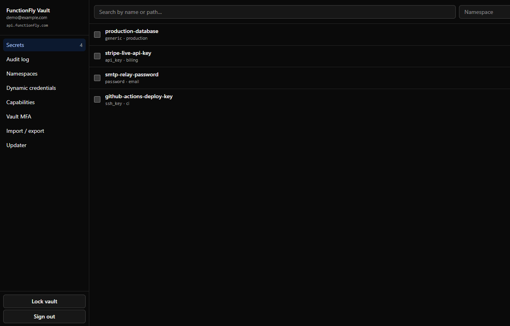
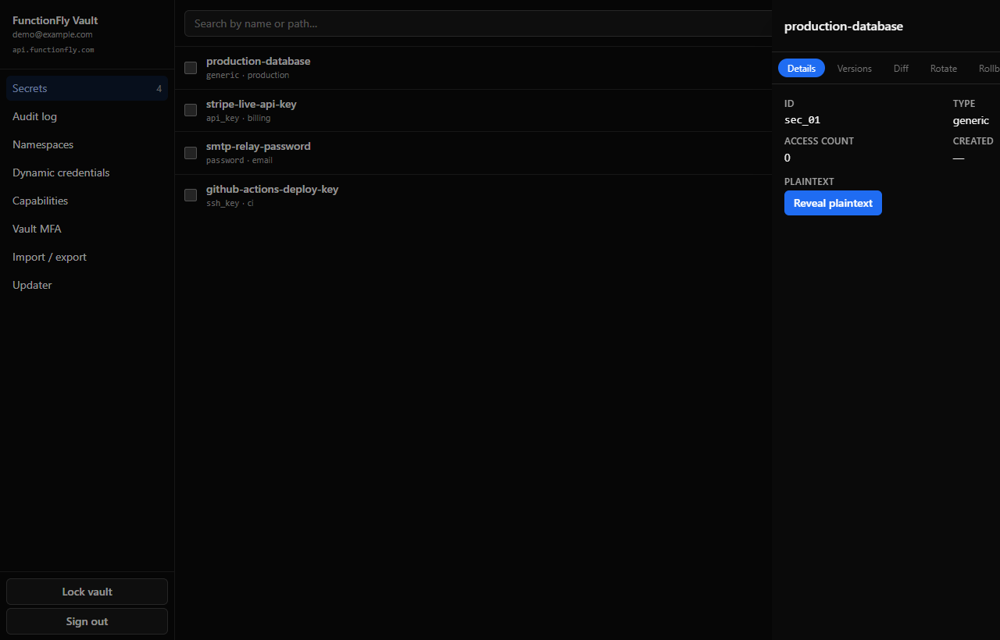
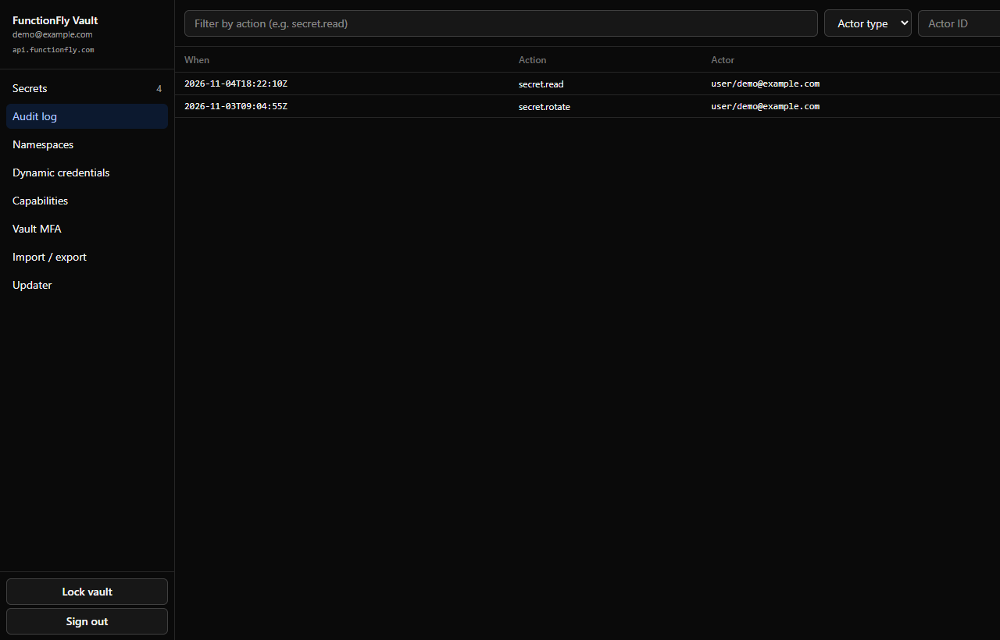
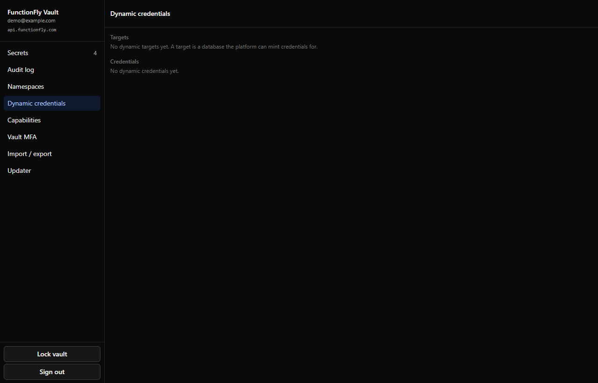
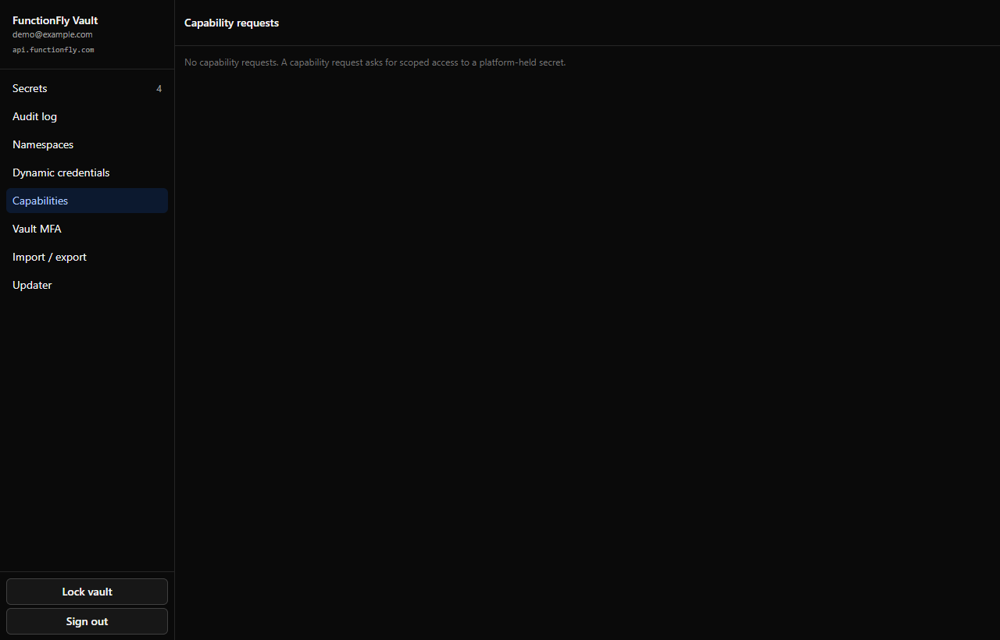
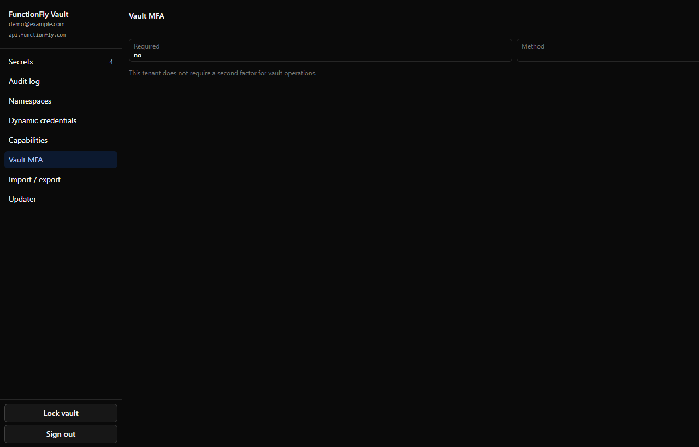
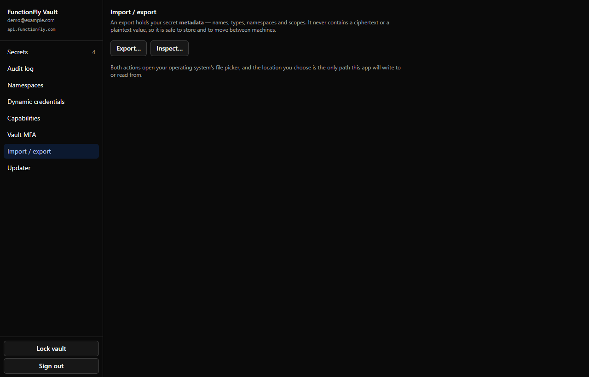
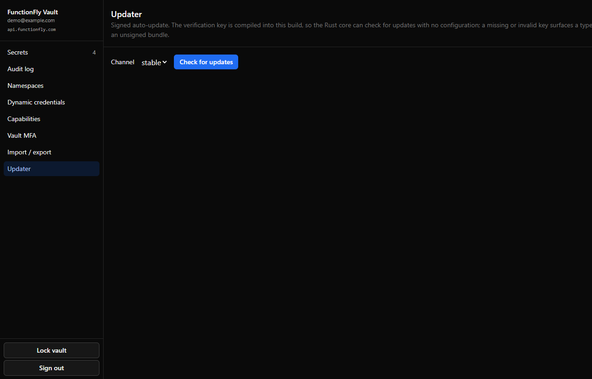

# FunctionFly Vault Desktop

Cross-platform desktop client for the FunctionFly zero-knowledge secrets API.
Built on Tauri v2 (Rust core + React webview) and packed into a single binary
for Windows, macOS, and Linux.

> **Status: 2026-11-05 — v1.0.1 is released.**
> The installers are published at
> [the v1.0.1 release](https://github.com/functionfly/vault-desktop/releases/tag/v1.0.1)
> (Windows `.exe` + `.msi`, Linux AppImage + `.deb`), each with the Ed25519
> signature the updater verifies, and the `stable` updater channel serves six
> signed platform keys from
> [`updates.functionfly.com`](https://updates.functionfly.com/vault/stable/manifest.json).
> The Ed25519 signature protects the update channel; it is **not** a platform
> vendor signature — see [Known limitations](#known-limitations).
>
> Rust core: `cargo clippy --all-targets -- -D warnings` clean; **129 Rust tests** passing (81 unit + 19 orchestrator-mock + 10 device-flow + 6 security-contract + 3 published-artefact-contract + 4 updater-artefact-contract + 4 updater-config + 2 OS-keychain). React bundle: `tsc` + `vite build` clean, **105 vitest** passing.
> Signed auto-update is wired with the Ed25519 public key compiled into the binary, so an installed client can verify updates without any environment variable. The webview runs under a strict Content Security Policy, and the IPC surface has been through a STRIDE review — see [`docs/SECURITY-REVIEW.md`](docs/SECURITY-REVIEW.md).
> The OS keychain round-trip, the release-manifest contract and the leak guard are all automated and run in the portable CI runner. Code-signing configuration is in place but the certificates are not provisioned, so the installers are not yet signed by a platform vendor — macOS has no installer at all yet (see [Known limitations](#known-limitations)).

## Screens

The interface, as it actually is. These are the real UI rendered against
the browser mock (see [Screenshots](#screenshots) below) — every value in
them is fictional.

| Secrets | A secret's detail |
| --- | --- |
|  |  |

| Audit log | Dynamic credentials |
| --- | --- |
|  |  |

| Capabilities | Vault MFA |
| --- | --- |
|  |  |

| Import / export | Updater |
| --- | --- |
|  |  |

## What it does

- Signs into the FunctionFly orchestrator (email + password, or `ffp_` API key).
- Persists the access + refresh tokens in the OS keychain (Keychain / Credential Manager / libsecret). The webview never sees them.
- Holds the unlock passphrase in process memory only, wiped on lock and on window close.
- Reads, searches, creates, edits, reveals, diffs, rotates, rolls back, and deletes secrets. Decryption **and encryption** happen in the Rust core against PBKDF2-HMAC-SHA256 + AES-256-GCM, with the same wire format as the dashboard and the Go SDK.
- Lists namespaces and the audit log, with per-secret audit trails.
- **Platform-held secrets** — ask the platform to hold the value instead of
  encrypting it locally. Opt-in, explained in the UI, gated on the ADMIN
  tenant role. It widens the trust boundary, so it is never the default.
- **Capability grants** — list, approve, deny and revoke scoped access requests.
- **Dynamic credentials** — manage database targets and credential definitions,
  mint a live credential and its lease, renew or revoke it. A minted
  credential's username and password are shown exactly once and never persisted.
- **Tenant vault MFA** — read the tenant's policy and verify a TOTP code. The
  code travels in a header, never in a query string, because proxies log query
  strings.
- **Sharing and federation** — share a platform-held secret with another
  tenant member, list what has been shared with you, revoke a share, and manage
  federation keys.
- **Audit chain integrity** — the tenant's audit hash chain: its posture, its
  segments, whether each anchor still verifies, and the first entry that fails.
- **Import / export** of secret *metadata* — never a ciphertext, never a
  plaintext.
- **Idle auto-lock** — the vault locks itself after a period of inactivity.
- **Clipboard auto-clear** — a revealed secret copied to the clipboard is wiped
  after 30 seconds, without destroying anything you copied in the meantime.

Secret values are **encrypted locally** before they leave the process: the
webview passes plaintext to the Rust core, which derives the key from the
unlock passphrase and sends only the `encrypted_data` payload to the
orchestrator. The server never sees a plaintext secret.

## Screenshots

The images in [Screens](#screens) are the real interface, rendered in a
browser against the app's own React code.

### Why there is a browser mock

The app is a Tauri application: its UI is a React webview talking to a
Rust core over an IPC channel. Opened in a plain browser there is no
host, so every IPC call throws and the page renders nothing.

`src/lib/browser-mock.ts` stands in for the Rust core when the app is
loaded with `?mock=1` **and** it is not running inside Tauri. It answers
the same commands with the same shapes, using fictional data — no real
tenant, no real secret.

Three properties keep it out of the shipped app:

1. It is behind `import.meta.env.DEV`, so the production bundle contains
   no mock code path at all.
2. It is behind a dynamic `import()`, so it is a separate chunk that is
   never fetched in production.
3. `shouldInstallMock()` returns false when `__TAURI_INTERNALS__` is
   present, so the real app can never install it even in a dev build.

### Regenerating them

```bash
bun run dev
# then open http://127.0.0.1:5184/?mock=1
```

The mock data lives at the top of `src/lib/browser-mock.ts`. Change it
and reload to see the new data.

## Architecture

```
React webview (TypeScript, Vite)
  │
  │  invoke() — typed IPC, single src/lib/ipc.ts wrapper
  ▼
Rust core (Tauri v2 commands)
  │
  ├─ crypto.rs      PBKDF2 / Argon2id + AES-GCM, byte-identical to dashboard
  ├─ api.rs         Orchestrator HTTP client (reqwest + rustls)
  │                  - attaches bearer + X-CSRF-Token
  │                  - retries once on csrf_token_invalid
  ├─ store.rs       OS keychain + in-memory unlock passphrase (Zeroizing)
  ├─ cache.rs       Offline metadata cache (metadata only, never ciphertext)
  ├─ commands/      The typed command surface, grouped by subsystem
  └─ error.rs       AppError serialises as {kind, message} over IPC
```

A capability manifest (`src-tauri/capabilities/default.toml`) closes every
default-on Tauri permission except `core:default`, the explicitly listed
`core:window:set-title` + `core:window:allow-theme` + `core:event`, and
`updater:default`. The webview has no `fs:*`, no `shell:allow-execute`, no
`http:*` — every network call is issued by the Rust core with the bearer
attached server-side, so a compromised webview cannot exfiltrate tokens.

The webview also runs under a restrictive Content Security Policy
(`script-src 'self'`, no inline script, no `eval`), and the commands that
touch the filesystem open the native file dialog themselves rather than
accepting a path — so a compromised renderer cannot direct the core at an
arbitrary file. Both properties are pinned by
[`src-tauri/tests/security_contract.rs`](src-tauri/tests/security_contract.rs).

The full review is [`docs/SECURITY-REVIEW.md`](docs/SECURITY-REVIEW.md).

## Build prerequisites

- Rust ≥ 1.90 (`rustup install stable`). The MSRV is 1.90 because the Tauri
  v2 dependency graph declares it — not 1.80, which was declared until
  2026-11-03 and never actually buildable.
- Node 20+ and `bun` (the dashboard monorepo already pins these).
- Tauri platform dependencies per the [Tauri v2 prerequisites](https://tauri.app/start/prerequisites/):
  - **Linux**: `libwebkit2gtk-4.1-dev`, `build-essential`, `libssl-dev`, `libgtk-3-dev`, `libayatana-appindicator3-dev`, `librsvg2-dev`.
  - **macOS**: Xcode Command Line Tools.
  - **Windows**: WebView2 Runtime (preinstalled on Windows 11) + MSVC build tools.

## Development

```bash
cd vault-desktop
bun install
# The Tauri CLI is a devDependency — `bunx tauri dev` starts the Vite dev
# server AND the Rust binary, and wires them together. Do NOT run
# `bun run dev` + `cargo run` separately: the standalone `cargo run` does
# not know the dev server's port, and the app comes up pointing at a URL
# nothing is serving.
bunx tauri dev
```

## Production build

```bash
cd vault-desktop
bun install
bun run build                      # tsc --noEmit && vite build
bunx tauri build                   # produces platform-specific bundles
```

The output for the host OS lands under `src-tauri/target/release/bundle/`:

| OS      | Format         | Path                     |
| ------- | -------------- | ------------------------ |
| Linux   | AppImage / deb | `bundle/{appimage,deb}/` |
| macOS   | .app / .dmg    | `bundle/{macos,dmg}/`    |
| Windows | .msi / .exe    | `bundle/{msi,nsis}/`     |

Cross-compilation from one host to another is supported but requires the
matching linker; the simplest path is a GitHub Actions matrix on three
runners (see `Deploy / CI`).

## Deploy / CI

> Branching model: [`docs/BRANCHING.md`](docs/BRANCHING.md). `develop` takes
> day-to-day work; `main` only ever holds released, tagged code.

> **GitHub Actions is not currently usable in this organisation.** Workflows
> are parsed and runs are created, but no runner is ever assigned — the jobs
> come back with `runner_id: 0` and no steps. It affects every repository in
> the org and needs an org admin. Until that is fixed, the gate set runs
> through the portable runner, described below.

`.github/workflows/`:

| Workflow | Trigger | What it does |
| --- | --- | --- |
| [`ci.yml`](.github/workflows/ci.yml) | push/PR to `main` or `develop` | `tsc` + vitest + vite build, `cargo fmt`/`clippy`/`test`, then a 3-OS compile matrix, plus `bash -n` + self-tests over `scripts/release/`. |
| [`release-please.yml`](.github/workflows/release-please.yml) | push to `develop` | Conventional Commits → SemVer bump → opens the `chore(release): vX.Y.Z` PR into `main`, updating the CHANGELOG and all three version files. |
| [`release.yml`](.github/workflows/release.yml) | `v*` tag | Verifies the tag against every version source, builds + signs installers on 3 OSes, creates a **draft** GitHub Release, and optionally publishes the updater manifest to R2. |
| [`branch-flow.yml`](.github/workflows/branch-flow.yml) | PR to `main`/`develop` | Rejects invalid head→base pairings and non-Conventional-Commit titles. |
| [`codeql.yml`](.github/workflows/codeql.yml) | push/PR + weekly | Static analysis for Rust and TypeScript. |
| [`dependency-review.yml`](.github/workflows/dependency-review.yml) | PR | Vulnerable-dependency diff plus `cargo audit` over `src-tauri/Cargo.lock`. |

Nothing is tagged by hand — merge the release PR and release-please tags it.

### The portable runner is the gate, not a fallback

[`scripts/ci.sh`](scripts/ci.sh) runs the same gates `ci.yml` runs, on any
machine. While Actions has no runner, **this is what gates a merge**, and
it publishes its result back to the pull request as a check run:

```bash
scripts/ci.sh                # every gate
scripts/ci.sh --quick        # skip the slow Tauri compile
scripts/ci.sh --job rust     # one job only
scripts/ci.sh --report       # publish a check run to the pull request
scripts/ci.sh --check-parity # fail if the runner and ci.yml have drifted
```

It needs no GitHub account, no runner registration and no Actions minutes:

```bash
# Docker (reproducible, needs only a Docker daemon)
docker build -f scripts/ci/Dockerfile -t vault-ci .
docker run --rm -v "$PWD:/src" -w /src vault-ci

# Or directly, on any machine with bun + cargo + python3
scripts/ci.sh
```

`--check-parity` is what keeps the two honest: it greps `ci.yml` for every
probe the runner executes and fails if one is missing, so the runner cannot
quietly fall behind the workflow.

### The macOS compile gate

[`scripts/macos-typecheck.sh`](scripts/macos-typecheck.sh) type-checks the
macOS build **on a Linux host**. It is a compile gate, not a build: it
produces no `.app` and no `.dmg`, because that needs the Apple SDK, the
Tauri macOS bundler and an Apple Developer ID certificate — none of which
exist on Linux.

It exists because the release workflow's `macos-latest` job cannot start
while the organisation's GitHub billing is unsettled. Without it, a
macOS-only compile error would go unnoticed until a macOS runner finally
exists.

```bash
./scripts/macos-typecheck.sh            # check
./scripts/macos-typecheck.sh --clean    # from a cold target directory
```

It needs [zig](https://ziglang.org/download/) (which bundles the macOS
libc headers and emits Mach-O objects), LLVM 17+ (for
`llvm-install-name-tool`, which CMake demands for a Darwin build) and
`cmake`. The script skips itself with an explicit notice when zig is
absent, so a host without it still runs every other gate.

### The release pipeline does not need Actions either

`release-please` is a
CLI (`npx release-please release-pr`), not an Action, and the signed
builds are `tauri build` — so a release can be cut from any machine that
holds the signing key:

```bash
npx release-please release-pr --repo-url=functionfly/vault-desktop \
  --target-branch=main --config-file=release-please-config.json \
  --manifest-file=.release-please-manifest.json
```

### Secrets the release needs

`release.yml` is the only workflow that ever sees the updater signing key.

| Secret | Required | Purpose |
| --- | --- | --- |
| `RELEASE_PLEASE_TOKEN` | for automated releases | PAT with `contents: write` + `pull-requests: write`. The CI policy blocks `GITHUB_TOKEN` from creating PRs, so release-please cannot run without this. |
| `TAURI_SIGNING_PRIVATE_KEY` | **yes** | Ed25519 updater signing. Absent → the release fails closed rather than shipping an unsigned artefact the updater would reject anyway. |
| `TAURI_SIGNING_PRIVATE_KEY_PASSWORD` | **yes** | Passphrase for the above. |
| `R2_ACCOUNT_ID`, `R2_ACCESS_KEY_ID`, `R2_SECRET_ACCESS_KEY`, `R2_BUCKET` | no | Publishes the updater manifest. When unset the installers still publish and the job logs how to run `publish-update.sh` by hand. |
| `INTERNAL_IDENTIFIERS` | for the leak guard | The exact identifiers that must never be published (bucket account id, access key id, key fingerprint, operator home path, owner handles). The leak guard's generic patterns live in the script; the project-specific values live here, so publishing the repository does not publish the blocklist. |
| `APPLE_*`, `WINDOWS_CERTIFICATE*` | no | Notarisation / code signing. The *configuration* is in place (`bundle.macOS.entitlements`, `bundle.windows`); the certificates are not — they need a paid Apple Developer Program membership and a Windows code-signing certificate. `scripts/release/check-signing-readiness.sh` reports the gap, and `release.yml` runs it before the build. |

### Known gaps

- **GitHub Actions cannot get a runner.** Workflows parse and runs are
  created, but the jobs come back with `runner_id: 0` and no steps. The
  portable runner gates merges in the meantime; see above.
- **Static analysis does not currently gate merges.** Code scanning requires a
  Code Security licence this repository's org does not hold. The workflow
  probes for it and skips with a notice rather than sitting red, so it
  re-enables itself the moment the licence is added.
- **Automated changelog releases are blocked** for the same class of reason —
  see the manual procedure in [`docs/BRANCHING.md`](docs/BRANCHING.md).

> Deployment specifics (bucket identifiers, key paths, owner handles, and the
> org's CI policy constraints) are deliberately kept out of this document.
> They live in the maintainers' private runbook, which is not part of this
> repository. The leak guard that enforces this reads its blocklist from a
> git-ignored file locally and from the `INTERNAL_IDENTIFIERS` secret in CI.

### Local checks that mirror CI

```bash
bun install --frozen-lockfile
bunx tsc --noEmit && bunx vitest run && bunx vite build

cd src-tauri
cargo fmt --all -- --check
cargo clippy --all-targets
cargo test --lib
cargo test --test orchestrator_mock
cargo test --test device_flow
cargo test --test updater_config
cargo tauri build --no-bundle   # packaging suppressed; see ci.yml for why
```

## Crypto interop guarantee

The Rust core's `crypto::encrypt` / `crypto::decrypt` produce values the
dashboard's `vault-crypto.ts` can decrypt byte-for-byte, and vice versa:

- PBKDF2-HMAC-SHA256, 16-byte salt, 600 000 iterations (`key_version = 2`).
  Legacy `key_version = 1` (100 000 iterations) is read-only.
- Argon2id (`key_version = 3`), 64 MiB / 3 iterations / 4 lanes, matching
  the Go SDK's `DefaultArgon2Params()` exactly. Versions 1 and 2 keep their
  exact PBKDF2 meaning, so nothing that was written before changes.
- AES-256-GCM, 12-byte nonce.
- Ciphertext on the wire is `base64(ct ‖ tag)`, `tag` field empty. The
  `normalized()` method accepts the detached-tag form too so payloads written
  by a Go-native client also decrypt.
- DEK envelopes (`encrypt_under_dek` / `decrypt_under_dek`), the byte-exact
  counterpart of the Go SDK's `EncryptUnderDEK`, so a value sealed under a
  tenant's data-encryption key can be read here.

An unknown `key_version` is **rejected**, never guessed.

Pinned by the unit tests in `src-tauri/src/crypto.rs::tests` covering:
roundtrip, wrong passphrase, salt/IV uniqueness, legacy-v1 read, unknown
key-version rejection, detached-tag normalization, AEAD tag tampering,
missing salt, DEK wrap/unwrap, 32-byte DEK length guard, zeroize,
Argon2id roundtrip and wrong-passphrase rejection, and
empty/Unicode/50KB plaintext roundtrip.

## Tests

| Suite                                        | Count | Command                                  |
| -------------------------------------------- | ----- | ---------------------------------------- |
| Rust unit tests                              | 80    | `cargo test --lib`                       |
| Orchestrator mock (HTTP + CSRF contract)    | 19    | `cargo test --test orchestrator_mock`    |
| Device-flow (RFC 8628 device grant)         | 10    | `cargo test --test device_flow`          |
| Security contract (IPC posture)              | 6     | `cargo test --test security_contract`    |
| Updater artefact contract                    | 4     | `cargo test --test updater_artifact_contract` |
| Updater config contract                      | 4     | `cargo test --test updater_config`       |
| OS keychain round-trip                       | 2     | `cargo test --test keychain_smoke`       |
| Frontend IPC + theme contract                | 100   | `bunx vitest run`                        |
| **Total**                                    | **225** | |

The release tooling has its own suite — `bash scripts/release/publish-update.test.sh` —
which asserts the updater manifest contract rather than merely checking that
a manifest file exists.

## Auth & security

- **Bearer + CSRF**: every mutating call to `/v1/vault/*` requires
  `Authorization: Bearer <token>` **and** `X-CSRF-Token: <csrf>`. The
  Rust core fetches one CSRF token at session start and refreshes it
  once on a 403 with `csrf_token_invalid` in the body. The dashboard
  sidesteps this by using relative URLs; we do not, so the same code
  path works against a remote orchestrator.
- **Captcha**: `POST /v1/auth/login` is captcha-gated server-side when
  `ENVIRONMENT=production`. A 503 from the orchestrator (no captcha
  provider configured) is surfaced as a typed `ApiError::Api { code:
"captcha_not_configured" }` and the UI tells the user to use an
  API key.
- **Refresh tokens are single-use**: the old token is revoked at the
  server before the new one is issued. We persist the new pair
  immediately, so a crash between the swap and the persistence loses
  the session at worst.
- **OS keychain**: `KEYRING_SERVICE = "functionfly-vault-desktop"`
  (distinct from Studio's `functionfly-studio` namespace, so a
  single keychain can host both without collision).
- **Idle auto-lock runs in the core, not the webview.** The countdown is a
  Rust-side deadline; the renderer only reports activity. A compromised
  renderer cannot talk the app out of locking.
- **Clipboard auto-clear**: a revealed secret copied to the clipboard is
  wiped after 30 seconds. The wipe compares the clipboard against the
  copied value first, so it never destroys something copied afterwards —
  and if the clipboard cannot be read, the wipe happens anyway, because
  failing to read is not evidence that it holds something else.
- **Content Security Policy**: the webview runs under `script-src 'self'`
  with no inline script and no `eval`, `connect-src` limited to the IPC
  origins, and `object-src` / `base-uri` / `form-action` /
  `frame-ancestors` at `'none'`.
- **No path crosses the IPC boundary.** The commands that touch the
  filesystem open the native file dialog themselves. An earlier shape
  took the path as an argument, which made the core a confused deputy:
  the webview has no `fs:*` scope, but it could name any path and have
  the core read or write it — so the missing scope bought nothing.
- **Plaintext never reaches a `Debug` format.** The type that carried a
  plaintext field was deleted, and the ciphertext envelope has a
  hand-written `Debug` that reports only the shape of the envelope — never
  the ciphertext, nonce or salt, which are the entire offline attack
  surface.

See [`docs/SECURITY-REVIEW.md`](docs/SECURITY-REVIEW.md) for the full
STRIDE review and the residual risks that are accepted for this release.

## IPC surface (webview → Rust)

All commands are declared in `src-tauri/src/lib.rs` via
`tauri::generate_handler!`. Every one returns a JSON value or a structured
`AppError { kind, message }`.

| Command                                        | Returns                                                    | Auth required      |
| ---------------------------------------------- | ---------------------------------------------------------- | ------------------ |
| `login`                                        | `{ user, desktop_capable }`                                | —                  |
| `login_with_api_key`                           | same                                                       | —                  |
| `begin_device_login`                           | `DeviceCodePrompt`                                         | —                  |
| `await_device_login(input)`                    | `{ user, desktop_capable }`                                | —                  |
| `restore_session`                              | `{ user?, refreshed, base_url? }`                          | —                  |
| `logout`                                       | —                                                          | —                  |
| `unlock_vault(passphrase)`                     | —                                                          | session            |
| `lock_vault`                                   | —                                                          | session            |
| `vault_status`                                 | `{ authenticated, unlocked, user? }`                       | —                  |
| `vault_health_probe`                           | `{ reachable, latency_ms? }`                               | —                  |
| `vault_store_info`                             | `{ backend, location? }`                                   | —                  |
| `list_secrets(query)`                          | `{ secrets[], total }`                                     | session            |
| `get_secret(id)`                               | `SecretResponse`                                           | session            |
| `create_secret(input)`                         | `SecretResponse`                                           | session + unlocked |
| `update_secret(input)`                         | `SecretResponse`                                           | session            |
| `rotate_secret(input)`                         | `SecretResponse`                                           | session + unlocked |
| `delete_secret(id)`                            | —                                                          | session            |
| `list_secret_versions(id)`                     | `{ versions[], total }`                                    | session            |
| `reveal_secret(id)`                            | `{ secret_id, plaintext }`                                 | session + unlocked |
| `diff_secret_versions(id, from, to)`           | `SecretVersionDiffResponse`                                | session            |
| `rollback_secret(id, target_version, reason?)` | `RollbackSecretResponse`                                   | session            |
| `list_namespaces`                              | `{ namespaces[], total }`                                  | session            |
| `create_namespace(name)`                       | `NamespaceResponse`                                        | session            |
| `delete_namespace(id)`                         | —                                                          | session            |
| `list_tokens(secret_id)`                       | `{ tokens[] }`                                             | session            |
| `generate_token(input)`                        | `TokenResponse` (plaintext once)                           | session + unlocked |
| `revoke_token(token_id)`                       | —                                                          | session            |
| `bulk_delete_secrets(input)`                   | `{ previews, blockers }`                                   | session            |
| `list_audit(secret_id?, limit?)`               | `{ entries[], total }`                                     | session            |
| `list_audit_by_action(action, limit?)`         | `{ entries[], total }`                                     | session            |
| `list_audit_by_actor(actor_type, actor_id, …)` | `{ entries[], total }`                                     | session            |
| `vault_check_update(channel)`                  | `{ result: "up_to_date" }` or `{ result: "available", … }` | — (fail-closed)    |
| `vault_apply_update(channel)`                  | `{ installed: { version } }`                               | — (fail-closed)    |

### Platform commands (v1.0.0)

These wrap the orchestrator's platform, capability, dynamic-credential,
sharing, federation and audit-chain routes. They follow the same rules as
everything above: the bearer and CSRF token are attached by the core, and
no plaintext secret crosses the boundary except on the explicit reveal and
mint paths the user just asked for.

| Command                                        | Returns                                 | Auth required      |
| ---------------------------------------------- | --------------------------------------- | ------------------ |
| `get_audit_chain` / `verify_audit_chain`       | chain posture, segments, first break    | session            |
| `list_capabilities` / `approve_capability` / `deny_capability` / `revoke_capability` | grant state | session |
| `get_secret_presence(id)`                      | `{ zk_mode, present, current_version? }` | session            |
| `get_mfa_config` / `verify_mfa(code)`          | tenant policy, TOTP verdict             | session            |
| `create_dynamic_target` / `list_dynamic_targets` / `delete_dynamic_target` / `test_dynamic_target` | target state | session |
| `create_dynamic_credential` / `list_dynamic_credentials` | credential definitions           | session            |
| `generate_dynamic_credential(id, ttl?)`        | username + password **once**            | session + unlocked |
| `renew_lease` / `revoke_lease` / `revoke_dynamic_credential` | lease state      | session            |
| `share_secret` / `list_shared_secrets` / `revoke_share` | share state                | session            |
| `list_federation_keys` / `create_federation_key` | federation key state                 | session            |
| `export_secrets` / `read_secret_export`        | metadata export, opened via a native dialog | session        |
| `read_metadata_cache` / `clear_metadata_cache` | offline metadata cache                  | —                  |
| `report_activity` / `get_idle_settings` / `set_idle_settings` | idle-lock control | —                  |

## Updater (signed auto-update)

The vault ships with a signed auto-update flow backed by
`tauri-plugin-updater`. It mirrors the FunctionFly Studio Phase 5
contract but with the vault-specific env-var names:

| Env var                    | Required | Default                                                                    | Purpose                                                      |
| -------------------------- | -------- | -------------------------------------------------------------------------- | ------------------------------------------------------------ |
| `VAULT_UPDATER_PUBKEY`     | no       | the key compiled into the binary (see below)                               | Ed25519 public key **override** — point a build at a rotated or staging key |
| `VAULT_UPDATER_STABLE_URL` | no       | `https://updates.functionfly.com/vault/stable/manifest.json`              | Stable-channel update manifest endpoint                      |
| `VAULT_UPDATER_BETA_URL`   | no       | `https://updates.functionfly.com/vault/beta/manifest.json`                | Beta-channel update manifest endpoint                        |

> **The endpoint is the channel's static manifest.** It carries no version
> placeholder. `tauri-plugin-updater` substitutes only `{{current_version}}`,
> `{{target}}`, `{{arch}}` and `{{bundle_type}}` — there is no
> `{{target_version}}` token, and a URL containing one is requested
> verbatim and 404s.

**Where the verification key comes from.** The Ed25519 public key lives in
`plugins.updater.pubkey` in `src-tauri/tauri.conf.json`, and Tauri compiles
it into the binary. That is what makes auto-update work for an ordinary
user, who installed the app and has no environment variables set.

`VAULT_UPDATER_PUBKEY` is an **override**, not the primary source: when it
is set to a non-blank value it wins, so an operator can point a build at a
rotated or staging key without rebuilding. The resolution order is:

1. `VAULT_UPDATER_PUBKEY` (if set and non-blank)
2. `plugins.updater.pubkey` compiled into the binary
3. neither → typed `missing_pubkey` error, no manifest is fetched

**Fail-closed contract.** Every `vault_check_update` and
`vault_apply_update` call resolves the key at call time. If no key is
available at all, the call raises a typed `missing_pubkey` error — the
Rust core refuses to fetch any manifest, the webview surfaces the code in
a typed error envelope, and a blank per-channel URL raises
`invalid_endpoint`. There is no fallback to an unsigned update.

> **Do not delete the `plugins.updater` block from `tauri.conf.json`.**
> It looks like dead config because `commands/updater.rs` overrides the
> endpoints at runtime — but the plugin's `Config` struct has a
> `pubkey: String` field with no serde default, so an absent section
> deserialises as `null` and the app **panics on startup**:
>
> ```
> PluginInitialization("updater", "Error deserializing 'plugins.updater' within
> your Tauri configuration: invalid type: null, expected struct Config")
> ```
>
> The empty `endpoints` list is an intentional placeholder: the per-channel
> URLs are supplied at runtime. The `pubkey` is **not** a placeholder — it
> must hold the real key, because the Tauri CLI reads this same field when
> it signs the updater artefacts. An empty pubkey makes the *release build*
> fail at the signing step, which no CI gate would otherwise catch (CI
> builds with `--no-bundle`, which produces nothing to sign).

**Keeping the two keys in sync.** The CLI signs artefacts with
`TAURI_SIGNING_PRIVATE_KEY` but reads the verification key from
`tauri.conf.json`. If the two ever drift apart, the release still builds
and still publishes — and every update fails verification on a user's
machine. `scripts/release/verify-updater-keypair.sh` turns that into a
hard failure and runs in the portable runner and in `release.yml`.

**Operator-side release flow** (the canonical contract is mirrored
in `src-tauri/src/updater.rs`). Three shell scripts ship in
`scripts/release/` to make the build-host side reproducible and
fail-closed:

```bash
# Once per build host — generates the signing keypair under $VAULT_KEY_DIR
cargo-tauri signer generate -w "$VAULT_KEY_DIR/vault-key.json"

# Once per environment (staging + production) — provisions the R2 bucket
# CF_ZONE_ID + CLOUDFLARE_API_TOKEN attach the public custom domain;
# without them the bucket is credentialed-only and the updater cannot
# fetch the manifest.
R2_ACCOUNT_ID=… R2_ACCESS_KEY_ID=… R2_SECRET_ACCESS_KEY=… \
  CF_ZONE_ID=… CLOUDFLARE_API_TOKEN=… \
  ./scripts/release/provision-r2-bucket.sh

# Every release — load env, build, publish
source ./scripts/release/load-updater-env.sh
bunx tauri build   # produces installer + side-car + .sig
# Publish every artefact in a directory, one manifest for all platforms:
./scripts/release/publish-updater-assets.sh stable 0.1.1 ./sidecars
```

The manifest is the contract `tauri-plugin-updater` reads. Three properties
are load-bearing, and each one has broken a release in the past:

| Property          | Value                                                                  | Why                                                                                       |
| ----------------- | ---------------------------------------------------------------------- | ----------------------------------------------------------------------------------------- |
| `platforms` keys  | `{os}-{arch}` and `{os}-{arch}-{installer}`                            | The plugin looks up exactly these. A Rust target triple (`x86_64-unknown-linux-gnu`) is never found. |
| `signature`       | The **content** of the `.sig` file (base64 minisign signature)          | The plugin base64-decodes this field and minisign-verifies the download against it. A URL here fails verification at install time. |
| `notes`           | A JSON string                                                          | The manifest is parsed as JSON. Shell-quoting the notes produces a document no client can parse. |

The installer format is part of the key because a `.deb` user must be offered
the `.deb` archive, not the AppImage that shares its architecture.
`scripts/release/updater-targets.py` owns that mapping and is asserted by the
release test suite.

| Script                                                    | Idempotent?                      | Touches R2?                              | What it does                                                                                                                                                                                                                     |
| --------------------------------------------------------- | -------------------------------- | ---------------------------------------- | -------------------------------------------------------------------------------------------------------------------------------------------------------------------------------------------------------------------------------- |
| `load-updater-env.sh`                                     | yes                              | no                                       | Exports `VAULT_UPDATER_PUBKEY`, `TAURI_SIGNING_PRIVATE_KEY_*`; prints a redacted manifest to stderr                                                                                                                              |
| `provision-r2-bucket.sh`                                  | yes                              | yes                                      | Creates the updater bucket, enables versioning, applies the noncurrent-version lifecycle rule, sets CORS, attaches the public custom domain, runs a write+read+delete round-trip probe and an anonymous public-reachability probe       |
| `publish-update.sh <channel> <version> <side-car> <sig> [target]` | no (idempotent at the S3 level) | yes                                      | Uploads the side-car + signature and merges that platform's entry into `vault/<channel>/manifest.json`. Accepts a comma-separated target list for a multi-arch archive. |
| `publish-updater-assets.sh <channel> <version> <dir>`    | no                               | yes                                      | Publishes every updater artefact in a directory, building one manifest across all platforms.                                                                                                                                    |
| `render-manifest.py`                                      | yes                              | no                                       | The manifest contract, in one place. Emits valid JSON; refuses a target triple, a non-base64 signature, or a repointed platform.                                                                                                    |
| `updater-targets.py`                                      | yes                              | no                                       | Maps an artefact filename to the manifest target keys the plugin looks up.                                                                                                                                                        |
| `publish-update.test.sh`                                  | yes                              | no (or yes, when `MOCK_R2_STORE` is set) | Arg-parsing smoke + the manifest contract assertions + the artefact→target mapping. The mock-R2 round-trip needs `python3` + `aws` and is otherwise inert.                                                |

Existing installs pick up the new manifest on their next
`vault_check_update(channel)` call (the user clicks **Check for
updates** in the sidebar). The Rust core downloads the
side-car, verifies the Ed25519 signature against
`VAULT_UPDATER_PUBKEY`, and schedules install on next restart.
**Why two channels.** The launch surface ships `stable` and `beta`.
A third "insider" rapid-iteration channel is a deliberate
follow-up — every extra channel multiplies the signing-key
rotation cost and the operator-surface area, and a security-critical
client does not need same-day insider builds.

## Env / config

The orchestrator URL is asked of the user at login and persisted in the
keychain alongside the tokens. Per-build settings (window title, identifier,
icon) live in `src-tauri/tauri.conf.json`.

The updater reads its configuration from the process environment at call
time — see [Updater (signed auto-update)](#updater-signed-auto-update) for
the full list. `VAULT_ORCHESTRATOR_URL` optionally seeds the login screen's
default orchestrator URL; it is a convenience, not a requirement.

### Brand mark / icons

The full icon set under `src-tauri/icons/` was generated by
`scripts/generate-icons.py` from a 1024×1024 master:

- `icon.png` — 1024×1024 master (Linux / `.deb` / AppImage)
- `icon.ico` — multi-resolution (16/24/32/48/64/128/256) for Windows
- `icon.icns` — macOS multi-resolution Apple icon container
- `32x32.png`, `128x128.png`, `128x128@2x.png` — Linux PNG sizes
- `Square*Logo.png` (10 × 30–310 px) — Windows MSI tile grid
- `StoreLogo.png` — Windows MSI store logo

Re-generate the whole batch:

```bash
python3.12 scripts/generate-icons.py
```

The script is deterministic; rerun it whenever the brand mark changes
(or commit the new icon set in the same PR as any UI re-skin).

## Known limitations

- **No secret-value edit in place.** Metadata (name / description / scopes)
  is edited via `PATCH`; changing the encrypted value is a _rotation_
  (`POST …/rotate`), surfaced as its own tab and recorded in the audit log.
  This matches the orchestrator's API split.
- **No deep-link / OAuth flow** for initial login. The user types
  credentials or pastes an API key; there is no browser-handoff.
- **Captcha in production** blocks email+password login unless the
  orchestrator is configured with a real provider. The UI tells the
  user to use an API key.
- **Encryption/decryption blocks the tokio worker** for ~0.3–1 s per
  operation (600k PBKDF2 iterations). Fine for explicit, low-frequency
  reveal/create/rotate actions; if parallel volume becomes a real
  workload, move the work onto a dedicated blocking thread.- **The installers are not code-signed.** macOS Gatekeeper and Windows
  SmartScreen will warn on first launch. The signing *configuration* is
  in place (entitlements, hardened runtime, SHA-256 digesting, a
  timestamping server) and takes effect the moment certificates are
  provisioned; the certificates themselves need a paid Apple Developer
  Program membership and a Windows code-signing certificate.
  `scripts/release/check-signing-readiness.sh` reports the gap.
- **There is no macOS installer.** The release workflow already declares
  a `macos-latest` job (`release.yml`), so the pipeline is correct — but
  that job cannot start while the organisation's GitHub billing is
  settled. Until it runs, the `stable` channel simply has no `darwin`
  keys and a macOS client is told there is no update available. The
  macOS-specific code is three `#[cfg(target_os = "macos")]` blocks
  that resolve the data directory, and it is type-checked on Linux in
  CI, so the macOS build is not expected to surprise us.
- **The updater signature is not the same thing as a platform signature.**
  The Ed25519 updater signature protects the *update channel* — it is
  what stops an attacker from serving a modified binary to an installed
  client. It does not satisfy Gatekeeper or SmartScreen, which want a
  platform vendor's signature on the installer itself.
## Smoke checks

Two of the three launch gates are automated and run in the portable
runner. The third —
against a live orchestrator — is still a human step, but the script that
performs it is now tested.

### Automated

**OS keychain** — `scripts/keychain-smoke.sh`. Round-trips a session
through the *real* credential store using the application's own
`SecretStore` code, then confirms the credential is visible through the
platform's own tooling, then removes it.

```bash
./scripts/keychain-smoke.sh
```

The critical assertion is that the backend actually used was
`BackendKind::OsKeychain`. `SecretStore` silently falls back to the
encrypted file store when the OS keychain is unreachable — correct for a
headless Linux box, and exactly what would hide a broken keychain on a
platform that *should* have one. On Windows and macOS a file fallback is
therefore a hard failure; on Linux the test skips with an explicit
notice.

> **The credential name differs per platform.** The `keyring` crate
> stores a Windows generic credential whose target is
> `{account}.{service}` — so the target is
> `orchestrator-access-token.functionfly-vault-desktop`, and
> `cmdkey /list:functionfly-vault-desktop` matches *nothing* and reports
> `* NONE *`. It looks like a broken keychain when it is working
> perfectly. macOS puts the service in the Keychain service attribute
> (`security find-generic-password -s functionfly-vault-desktop`), and
> Linux puts it in the Secret Service `service` attribute
> (`secret-tool search service functionfly-vault-desktop`).
> `scripts/keychain-smoke.sh` gets this right per platform.

**Staging smoke script** — `scripts/staging-smoke.test.sh`. The real
`scripts/staging-smoke.sh` has never been run against a real
orchestrator, so nothing about it was known to work. This drives the
**unmodified** script against a mock orchestrator that *enforces* the
security contract — bearer on every `/v1/*` route, CSRF on every
mutation — and then asserts that the script never triggered a rejection
and never sent a CSRF header on a safe method.

```bash
./scripts/staging-smoke.test.sh
```

### Manual (still required)

The script above proves the *script* is correct. It does not prove the
orchestrator behaves the way the script expects. Before a release, run
the real thing against staging:

```bash
STAGING_BASE_URL=https://api-staging.functionfly.dev \
STAGING_EMAIL=you@example.com \
STAGING_PASSWORD=… \
  bash scripts/staging-smoke.sh
```

Then, per platform, with the built installer:

1. **Bundle and install**
   - `bun install && bun run build`
   - `cd src-tauri && bunx tauri build`
   - Install the artefact (`.AppImage` / `.dmg` / `.msi`) and confirm the
     first-launch keychain prompt.
2. **Log in and confirm the keychain**, using the platform-correct
   command from the table above.
3. **Prove the crypto interop** — list a secret, reveal it, copy the
   plaintext into a fresh terminal, and confirm it matches what the
   dashboard reveals for the same secret.
4. **Prove the write path** — create a secret from the desktop, reveal
   it, and confirm the plaintext round-trips. Confirm the dashboard can
   reveal the same secret.
5. **Rotate, roll back, delete** — rotate the secret with a new value,
   confirm the version count increments, reveal and confirm the new
   value; roll back to the prior version and confirm the value reverts;
   delete the secret and confirm it disappears from the list.
6. **Session lifecycle** — lock the vault and confirm the list still
   loads but **Reveal** is gated; sign out and confirm `/v1/vault/*`
   calls now return 401 and the UI returns to the login screen.

### Code signing

`scripts/release/check-signing-readiness.sh` reports whether the
current host could produce a signed, notarised installer:

```bash
./scripts/release/check-signing-readiness.sh              # advisory
./scripts/release/check-signing-readiness.sh --require    # fail closed
```

It runs in `release.yml` before the build and in the portable runner. The configuration
is in place — `bundle.macOS.entitlements` and `bundle.windows` — so
signing works the moment the certificates are provisioned. What is
**not** in place is the certificates themselves: they need an Apple
Developer Program membership and a Windows code-signing certificate,
neither of which this repository can supply.

Until they are provisioned, a macOS release is quarantined by Gatekeeper
and a Windows release shows the SmartScreen "unknown publisher" dialog.
On a secrets manager that warning does real damage, so set the
repository variable `REQUIRE_CODE_SIGNING=true` once the secrets exist
and the gate will fail an unsigned release rather than report it.

## Where this code came from

- **Tauri + keyring precedent**: the FunctionFly Studio desktop app — same
  Tauri version, same `keyring` crate version, same least-privilege
  capability shape.
- **Crypto contract**: the FunctionFly dashboard and the FunctionFly Go
  vault SDK. Both are authoritative; the Rust port is byte-exact with
  them, so a value encrypted by any one of the three round-trips in the
  others.
- **API surface**: the FunctionFly orchestrator's vault handlers, including
  its request/response shapes, its CSRF contract and its login response
  shape.

Those live in sibling repositories and are not part of this one. This
repository is the desktop client only.

## License

See `LICENSE` at the repo root.
